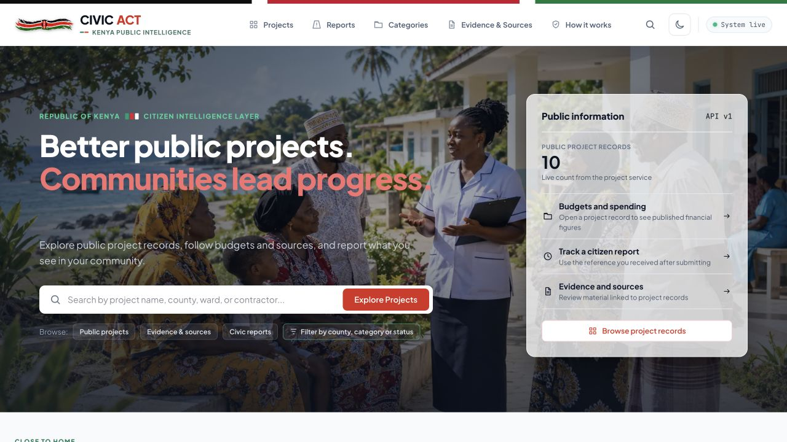
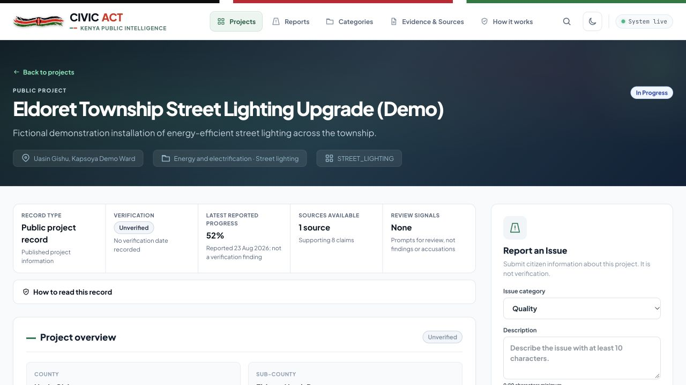
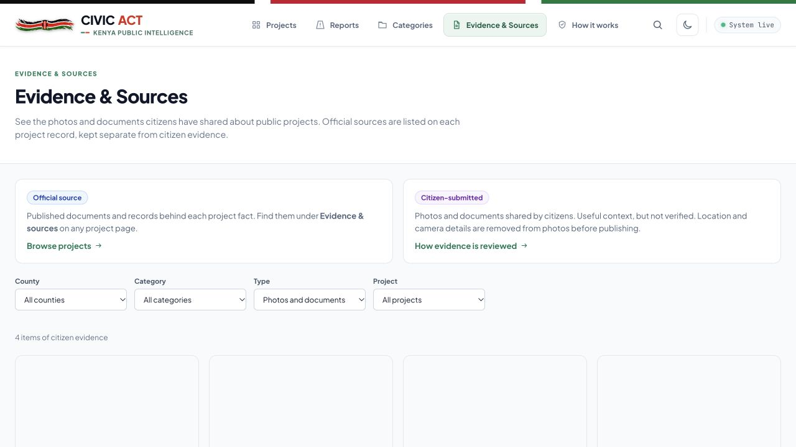

# Citizen Intelligence Layer

Citizen Intelligence Layer is a Kenyan public-interest platform for exploring public projects, understanding spending and sources, and sharing civic reports without presenting unverified information as fact.

The application is evidence-first: project records, official sources, citizen submissions, verification, and review signals are clearly presented as different kinds of information.



## What citizens can do

- Browse public project records by county, ward, category, project type, and lifecycle status.
- Search projects and keep the search, filters, and pagination in the URL.
- Read a project’s budget, timeline, contractor, reported progress, sources, evidence references, verification status, and review signals.
- Submit a citizen report or supporting evidence from the relevant project record.
- Track reports submitted from the current browser through **My reports**, or use a report reference from another device.
- Explore project categories, counties, evidence and sources, and guidance on how the platform works.

## Trust and safety model

The public interface uses clear language to distinguish content:

| Label | Meaning |
| --- | --- |
| **Public project record** | Published project information shown by the platform. |
| **Verified / Unverified** | The explicit verification state; a citizen report does not change it. |
| **Reported progress** | A project update, not an independent verification finding. |
| **Citizen submission** | A report, comment, photo, or document supplied by a citizen. |
| **Review signal** | A prompt for further checking, never an accusation or finding. |

Personal contact information, internal storage references, and contributor identifiers are not displayed publicly. Public moderation guidance is available under **Community safety**; moderation operations remain permission-restricted.

## Public pages

| Page | Purpose |
| --- | --- |
| `/` | Public-project discovery, county browsing, and civic-action entry points. |
| `/projects` | Searchable and filterable public-project catalogue. |
| `/projects/[id]` | Evidence-first project record and citizen-action surface. |
| `/reports` | Public report list, filters, and browser-local **My reports**. |
| `/categories` | Browse projects by category and subtype. |
| `/evidence` | Evidence and source guidance; evidence is primarily discovered in project context. |
| `/how-it-works` | Plain-language explanation of sources, verification, and review signals. |
| `/community-safety` | Public safety, privacy, and content-reporting guidance. |





## Run locally

The complete local stack includes the Next.js frontend, FastAPI backend, PostgreSQL, Redis, RabbitMQ, and a Celery worker.

```bash
docker compose up --build
```

Then open:

- Frontend: <http://localhost:3000>
- API documentation: <http://localhost:8000/docs>
- API health: <http://localhost:8000/health>
- Projects API: <http://localhost:8000/api/v1/projects>

To load the clearly labelled fictional Kenyan demonstration records:

```bash
docker compose exec api python -m app.seed_demo_data
```

The seed command is idempotent and creates demonstration data only.

## Development

Frontend only:

```bash
cd frontend
npm ci
npm run dev
```

The browser calls the same-origin frontend proxy. `/api/v1/*` is forwarded to FastAPI, while `/api/health` is forwarded to FastAPI’s health route. This keeps browser requests same-origin and avoids a separate CORS configuration.

Useful frontend checks:

```bash
cd frontend
npm run lint
npm run build
```

Backend verification is documented in [backend/AGENTS.md](backend/AGENTS.md).

## Architecture

- **Frontend:** Next.js 16, React 19, TypeScript, and Tailwind CSS 4.
- **Backend:** FastAPI, SQLModel, PostgreSQL, Alembic, Redis, Celery, and RabbitMQ.
- **API client:** `frontend/lib/api.ts` is the single typed boundary for browser and server API requests.
- **UI data loading:** reusable query hooks provide loading, timeout, retry, and stale-response handling.

See [frontend/README.md](frontend/README.md) for frontend implementation details and [backend/README.md](backend/README.md) for backend setup.
